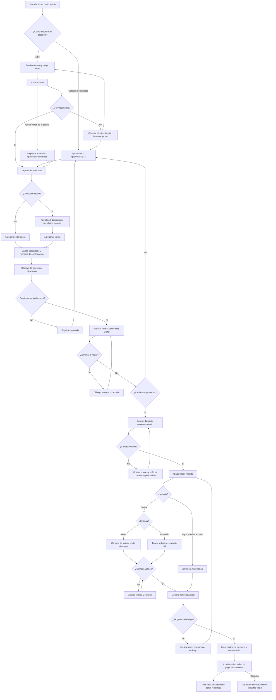

# Diagnóstico técnico y funcional de los flujos de usuario de NUDO

Fecha de revisión: 14 de octubre de 2026.  
Proyecto revisado: `C:\EJEMPLOS\PeluqueriaTurnos`.  
Versión local de referencia: rama `main`, HEAD `133d580caa20488bb4ccdd070b35ca097f660d28`.

## 1. Resumen y alcance de la revisión

**NUDO permite explorar productos, consultar sus fichas, buscar, filtrar, gestionar un carrito y completar un checkout simulado. No permite realizar una compra comercial real.** El recorrido de agregar un producto al carrito está implementado. El recorrido posterior termina en un ticket generado dentro del navegador, sin cobro, registro en servidor, correo de confirmación ni gestión real de entrega.

El problema principal es la diferencia entre lo que hace el programa y lo que comunica: la interfaz actual utiliza «Pago en línea», «Pago confirmado», «Pedido registrado» y «Código de verificación», aunque únicamente construye un objeto en memoria y una pantalla de confirmación. Los avisos explícitos de simulación presentes en una versión histórica ya no aparecen en las plantillas actuales.

Se revisaron completos `index.html`, `script.js`, `styles.css`, `README.md` y `AUDITORIA.md`. Se inspeccionaron el inventario de la raíz, `.gitignore`, los metadatos de `IA/package.json`, archivos auxiliares de benchmark y el historial local de Git. También se leyeron objetos históricos de Git para contrastar cambios concretos. Los archivos principales coinciden con HEAD al normalizar saltos de línea: las diferencias CRLF/LF no se interpretaron como cambios funcionales.

**Método y límites:**

- El diagnóstico se basa principalmente en revisión estática del código, complementada con ejecución aislada de lógica JavaScript en memoria.
- No fue posible probar la interfaz en un navegador: el navegador integrado no estaba disponible y la consulta de navegadores conectados devolvió una lista vacía. No se presentan como comprobadas la apariencia renderizada, las interacciones reales con teclado, el comportamiento del CDN o las dimensiones móviles.
- La herramienta de terminal falló al iniciar. La lectura se realizó mediante el acceso al sistema de archivos del entorno JavaScript; no se instalaron dependencias ni se ejecutaron scripts de instalación.
- Se comprobó la sintaxis completa de `script.js` mediante compilación con `vm.Script`. Se ejecutaron 14 comprobaciones de catálogo, búsqueda, filtros, ordenamiento, relacionados, costo de envío y validaciones. Todas dieron el resultado esperado, incluidos casos que confirman limitaciones.
- Además se ejecutaron el manejador real de aplicar filtros y las funciones de almacenamiento con objetos simulados, sin utilizar el almacenamiento real de un navegador.
- Las pruebas descritas en README y AUDITORIA son antecedentes documentales; no se atribuyen a esta revisión.
- No se verificó la publicación remota ni se auditó la infraestructura. El alcance es el sitio local y sus flujos.
- Los cinco pasos de Figma se utilizan exactamente como marco proporcionado en la solicitud. Esta revisión no pretende verificar una fuente bibliográfica de Figma ni demostrar que el proyecto se diseñó en esa herramienta.

Las referencias `archivo:línea` corresponden a los archivos locales revisados. Varias plantillas y reglas CSS ocupan líneas largas; por eso se añade también el nombre de la función o selector.

**Criterios:** «implementado» significa que existe lógica ejecutable que respalda la función; «parcial» indica una función con límites o una ruptura del recorrido; «no implementado» significa que no se encontró en el código del sitio. «No verificable» se reserva para cuestiones de proceso o comportamiento que la evidencia disponible no permite demostrar.

## 2. Qué es NUDO y qué ofrece

NUDO se presenta como una «botica contemporánea» de cuidado capilar y personal. La portada utiliza el mensaje «Tu naturaleza. Tu ritual.» y propone explorar productos para cabello, piel y rutinas de cuidado. Esto se verifica en `index.html:7` y `script.js:518`, dentro de `render()`.

### Usuarios y objetivos

El público que puede inferirse de la interfaz son personas que buscan productos para el cabello, peinado, barba y cuidado personal. Sus objetivos principales son explorar una categoría, localizar un producto, comparar información básica y reunir una selección en el carrito.

El checkout está contextualizado en Ecuador y presenta retiro en un local de Quito o envío a domicilio en Ecuador. El selector telefónico internacional no demuestra cobertura internacional de entregas.

No existen cuentas, inicio de sesión, perfiles diferenciados ni panel de administración. El visitante opera sin autenticación. No se encontraron personas de usuario, entrevistas, segmentación demográfica ni investigación que permitan afirmar edades, hábitos o perfiles más específicos.

### Oferta comprobada

El catálogo está escrito directamente en `script.js:3`, en el arreglo `products`. Contiene **60 productos con identificadores únicos**, precios entre **$7,00 y $21,00** y estas categorías:

| Categoría | Productos | Ejemplos reales |
| --- | ---: | --- |
| Cabello | 24 | Shampoo suave, Acondicionador nutritivo, Mascarilla reparadora |
| Estilo y barba | 15 | Cera de acabado mate, Limpiador de barba, Pomada mate |
| Cuidado personal | 7 | Crema de manos, Gel de ducha botánico, Bálsamo labial |
| Rizos y ondas | 7 | Acondicionador para rizos, Gel definidor de rizos |
| Cuero cabelludo | 7 | Tónico de cuero cabelludo, Shampoo de menta |

Cada producto tiene identificador, nombre, categoría, colecciones, presentación, precio, estilo de ilustración, etiqueta, descripción y beneficios. Los precios se manejan en centavos y se muestran con formato `es-EC` mediante `money()` (`script.js:149`). La interfaz usa el símbolo $, sin identificación constante de la moneda junto a cada precio.

También existen nueve colecciones en `script.js:120`: Cuidado diario, Peinado y fijación, Tratamientos, Cuidado de barba, Destacados, Shampoos, Acondicionadores, Cuero cabelludo y Rizos y ondas. Los productos pueden pertenecer a varias colecciones.

**Las colecciones no equivalen a las categorías visibles.** Sus rutas funcionan en el código, por ejemplo `#productos/coleccion-shampoos`, pero no se encontraron enlaces normales a esas rutas en las plantillas actuales de navegación. La portada y el catálogo priorizan las cinco categorías.

No hay reservas de peluquería, agenda de turnos, consultas profesionales ni contratación de servicios. El nombre de la carpeta «PeluqueriaTurnos» no describe una función existente del sitio.

### Tecnologías

| Componente | Implementación real |
| --- | --- |
| Estructura | HTML5, un único `index.html` |
| Presentación | CSS propio, Grid, Flexbox, consultas de medios, variables CSS |
| Lógica | JavaScript nativo; vistas generadas dentro de `#app` |
| Navegación | Fragmentos de URL y evento `hashchange` |
| Datos de productos | Arreglos y objetos en `script.js`; no catálogo JSON externo |
| Persistencia | `localStorage['nudo-cart-v1']`, únicamente identificadores y cantidades |
| Imágenes de productos | Ilustraciones de envases construidas con HTML/CSS |
| Iconos | Biblioteca SVG incluida en `index.html` |
| Teléfono | `intl-tel-input` 25.12.2 desde jsDelivr; selector nativo alternativo y bandera desde FlagCDN |
| Backend y pagos | No hay backend, API comercial ni pasarela de pagos integrada |

`IA/package.json` declara una herramienta de desarrollo; no está cargada por el HTML. Los archivos de benchmark de MySQL/Cassandra tampoco están conectados a las rutas, el carrito ni los formularios del sitio. Su presencia no permite afirmar que NUDO tenga base de datos.

## 3. Tabla de funcionalidades reales

| Funcionalidad | Estado | Qué hace realmente y evidencia |
| --- | --- | --- |
| Inicio y navegación principal | Implementado | Marca, Inicio, Productos, Carrito y búsqueda; `index.html:17`, `render()` |
| Catálogo de 60 productos | Implementado | Datos locales y tarjetas; `products`, `card()`, `script.js:281` |
| Categorías | Implementado | Cinco rutas por índice, categoría completa y vistas previas de otras; `categoryHref()`, `render()`, líneas 288 y 528 |
| Colecciones temáticas | Parcial en su acceso | Datos y rutas existen; faltan accesos visibles en la navegación actual; líneas 120, 499 y 537 |
| Detalle de producto | Implementado | Nombre, ilustración, precio, presentación, descripción y beneficios; línea 545 |
| Productos relacionados | Implementado | Cuatro sugerencias por afinidad de categoría/colecciones; `relatedProducts()`, línea 133 |
| Búsqueda | Implementado con límites | Coincidencia de texto sin tildes ni distinción de mayúsculas; `filteredProducts()`, `normalizeSearch()` |
| Filtros y orden | Parcial | Funcionan, pero aplicar controles de resultados pierde el término buscado; líneas 687–691 |
| Agregar al carrito | Implementado | Añade una unidad sin abandonar la vista; manejador de `data-add`, línea 577 |
| Cantidades | Implementado | Entre 1 y 99 unidades por producto; línea 596 |
| Eliminar y vaciar | Implementado | Diálogo de confirmación y cancelación; `requestCartConfirmation()`, línea 222 |
| Persistencia del carrito | Parcial | Se guarda localmente; sin sincronización entre pestañas ni caducidad; líneas 250–268 |
| Datos de contacto | Implementado como formulario local | Validación y paso a Pago; `shippingError()`, envío de `shipping-form`, línea 731 |
| Elección de pago y entrega | Implementado como simulación | Local/retiro, online/retiro y online/domicilio; `currentFulfillment()`, línea 291 |
| Validación de tarjeta | Parcial, solo formato local | Longitud, algoritmo Luhn, MM/AA y CVV; no verifica tarjeta ni fecha futura; `cardError()`, línea 327 |
| Cobro real | No implementado | No hay comunicación con procesador; el submit construye `order` en memoria |
| Ticket de confirmación | Implementado como simulación | Código aleatorio, artículos y totales; líneas 563 y 787 |
| Registro durable de pedidos | No implementado | `order` no se persiste; desaparece al recargar |
| Consultar/verificar un ticket | No implementado | No hay pantalla, consulta ni servidor asociado al código |
| Correo de pedido, factura y seguimiento | No implementado | No existen manejadores ni integraciones correspondientes |
| Stock y disponibilidad | No implementado | El límite 99 no representa inventario; el producto no tiene campo de existencias |
| Cuentas, favoritos, reseñas y cupones | No implementado | No existen pantallas ni lógica asociada |
| Adaptación móvil y accesibilidad | Parcialmente verificable | Hay implementación CSS/ARIA; su eficacia completa requiere prueba de navegador |

La ausencia de una función opcional no constituye por sí sola un defecto. La ausencia de cobros y pedidos durables sí impide interpretar el resultado como una tienda operativa.

## 4. Navegación y estructura real

### 4.1 Pantallas y rutas

No son documentos HTML separados: `render()` reemplaza el contenido de `main#app`.

| Ruta | Pantalla y condiciones |
| --- | --- |
| `#inicio` | Portada; ruta predeterminada |
| `#productos` | Catálogo general con una fila visible por categoría |
| `#productos/0` a `#productos/4` | Categoría completa, seguida de vistas previas de las demás |
| `#productos/coleccion-<id>` | Colección temática reconocida por el código |
| `#detalle/<id>` | Ficha de un producto existente |
| `#buscar/<texto>` | Resultados de búsqueda |
| `#carrito` | Selección actual o estado vacío |
| `#envio` | Datos de compra/contacto; pese al nombre de ruta, no solicita dirección |
| `#pago` | Pago y modalidad de entrega; requiere carrito y contacto validado |
| `#confirmacion` | Ticket; requiere un pedido temporal en memoria |

Los filtros se representan en parámetros dentro del fragmento, como `#productos?categoria=Cabello&precio=10-15&orden=price-asc`.

Las rutas desconocidas y los identificadores de producto inexistentes redirigen al catálogo sin explicación de «no encontrado». Una búsqueda con codificación inválida también vuelve al catálogo. Las restricciones de acceso al checkout están en `script.js:507`.

### 4.2 Organización de la portada

La estructura que genera `render()` contiene:

1. Franja superior de marca y mensaje.
2. Cabecera adherente al desplazamiento: marca, navegación y lupa.
3. Presentación principal con mensaje, botón «Explorar la botica» y escena ilustrada.
4. Bloque «Encuentra tu ritual» con cinco categorías y dos productos pequeños enlazados a sus fichas.
5. Franja de mensajes de cuidado.
6. Cinco secciones de productos, una por categoría, con «Ver todos los productos de…».
7. Pie con marca, acceso al catálogo, correo, teléfonos y dirección.

La vista previa limita mediante CSS los productos visibles de cada categoría: dos por debajo de 600 px, tres de 600 a 999 px y cuatro desde 1000 px. El resto se genera en el HTML pero queda oculto con `display:none`. «Ver todos» es la vía normal para descubrir los demás. Evidencia: `styles.css:213`, 234 y 245.

### 4.3 Categorías, catálogo y ficha

Se accede al catálogo desde Productos, «Explorar la botica», el pie, enlaces de regreso y el estado vacío del carrito. Las categorías tienen accesos directos en la portada.

Una categoría sin parámetros muestra todos sus productos y, debajo, «También puedes explorar» con las otras categorías. Al aplicar filtros, el listado pasa a una vista filtrada y desaparecen esas vistas previas.

Las tarjetas permiten abrir el detalle mediante ilustración, nombre o «Ver detalle», o añadir directamente una unidad. La ficha no obliga a pasar por más pantallas para agregar. Después presenta cuatro productos relacionados.

**Pérdida de contexto:** «Volver a la colección» en la ficha siempre apunta a `#productos`. No recupera la búsqueda, categoría, orden o posición desde la cual se abrió el producto. El botón Atrás del navegador puede recuperar la ruta anterior, pero `render()` desplaza al comienzo de la página y enfoca el título; no restaura la posición previa.

### 4.4 Búsqueda y filtros

La lupa despliega un formulario con término, categoría, precio y orden. Se cierra con ×, Escape o clic fuera. Buscar texto vacío conduce al catálogo con los filtros seleccionados.

La búsqueda examina nombre, categoría, descripción, etiqueta y beneficios. Normaliza mayúsculas y tildes, y usa `includes()` sobre el texto concatenado. No hay sugerencias, autocompletado de productos, corrección de errores ni búsqueda por palabras independientes.

Ejemplo comprobado: «serum» encuentra tres productos; «shampoo suave» encuentra uno, mientras «suave shampoo» no encuentra ninguno.

Rangos: menos de $10; $10 a $15 inclusive; más de $15, sin límite superior. El valor interno `15-20` no significa que el filtro termine en $20: incluye el producto de $21 y coincide con su etiqueta visible.

Orden: original de la lista, precio ascendente, precio descendente o nombre A–Z. Los cambios se aplican al enviar el formulario, no simplemente al cambiar una selección.

**Ruptura comprobada del recorrido:** el formulario de filtros mostrado dentro de los resultados llama al manejador de `script.js:687`, que siempre construye `productos + parámetros`. Por tanto, buscar «shampoo» y luego aplicar precio u orden abandona la búsqueda y devuelve productos ajenos al término. El mismo manejador también pierde la colección si se aplica desde una ruta de colección.

La búsqueda realizada directamente desde la lupa sí combina término y filtros. «Limpiar filtros» desde los resultados conserva el término mediante el formulario de búsqueda. Esta diferencia hace que controles visualmente parecidos tengan comportamientos distintos.

Cuando no hay resultados, se muestra una explicación y opciones para cambiar criterios, limpiar filtros o explorar el catálogo. No existe contador explícito de resultados en las plantillas.

### 4.5 Carrito y finalización

Agregar no cambia de pantalla. Actualiza el contador, muestra «Agregado» en el botón durante 1,8 segundos y una notificación durante 3,2 segundos, además del anuncio accesible. No hay un enlace a Carrito dentro de esa notificación; se utiliza la cabecera.

En Carrito se puede consultar precio unitario, presentación, importe por producto y total; sumar/restar; eliminar con confirmación; vaciar con confirmación; seguir explorando o continuar. Restar se deshabilita al llegar a una unidad: eliminar es una acción separada.

El guardado conserva solo `id` y `quantity`. `loadCart()` descarta productos desconocidos, duplicados y cantidades inválidas, y recupera los precios desde el catálogo.

El checkout tiene tres pasos visuales:

| Paso | Datos y decisiones | Resultado real |
| --- | --- | --- |
| Datos de compra/contacto | Primer nombre, primer apellido, correo y celular obligatorios; segundos nombres/apellidos opcionales; país telefónico | Validación local y permiso temporal para pasar a Pago |
| Pago | Local/retiro predeterminado, o pago online con domicilio/retiro | Validación de campos; no realiza transacción |
| Confirmación | Ticket de pago, retiro o envío | Objeto temporal y vista de resultado; carrito vacío |

En Ecuador el celular debe tener nueve dígitos y empezar por 9. Para otros países hay comprobaciones de dígitos y longitud máxima, pero no una validación completa del número nacional ni verificación de existencia. Los nombres requieren al menos dos letras; el correo exige una estructura básica.

Solo online/domicilio pide ciudad, dirección, complemento opcional y código postal de seis dígitos. No hay consulta de direcciones ni cobertura logística. El cargo es fijo: **$5,00**, definido en `deliveryFee()`.

Los campos de tarjeta solo aparecen online. El número debe tener entre 12 y 19 dígitos y superar Luhn; la fecha exige MM/AA con mes válido; el CVV, tres o cuatro dígitos. **La fecha no se compara con la fecha actual.** La ejecución aislada confirmó que `01/20` es aceptada.

Al cambiar método o entrega se reconstruyen los campos de tarjeta y se pierden los valores escritos, incluso al pasar de domicilio a retiro manteniendo pago online. Es un comportamiento del código; la confusión que produzca debe validarse con usuarios.

Confirmar genera un código aleatorio con `crypto.getRandomValues()`, copia artículos a `order`, conserva el destino en ese objeto si corresponde, vacía carrito/contacto/borrador de pago y sustituye Pago por Confirmación en el historial. El número de tarjeta no se copia a `order` ni a `localStorage`.

**Matiz de privacidad:** la dirección sí permanece en `order.destination` y se muestra en el ticket de domicilio. No es correcto afirmar que todo dato personal se elimina al confirmar. Nombre y contacto se limpian; la dirección permanece en memoria hasta recargar o invalidar ese pedido.

### 4.6 Inventario de elementos interactivos y enlaces

| Grupo | Acciones disponibles |
| --- | --- |
| Cabecera | Inicio, Productos, Carrito, lupa, búsqueda, filtros, cerrar y limpiar |
| Inicio/catálogo | Explorar, abrir categoría, ver todos, abrir ficha, agregar, aplicar/limpiar filtros |
| Ficha | Volver al catálogo, agregar, abrir relacionados, ver todos |
| Carrito | Abrir ficha, aumentar/disminuir, eliminar, vaciar, aceptar/cancelar diálogo, continuar |
| Contacto | Campos, país/prefijo, continuar, volver al carrito |
| Pago | Elegir método y entrega, introducir datos, editar contacto/carrito, finalizar |
| Confirmación | Seguir explorando y volver al inicio |
| Pie y ayudas | Correo `mailto:`, teléfonos `tel:`, ayuda postal externa |
| Accesibilidad | Salto al contenido, controles nativos, cierre con Escape |

Correo y teléfono son enlaces a aplicaciones del dispositivo; no son formularios de atención ni demuestran envío efectivo. La ayuda postal abre un sitio externo manualmente. No se comprobó su disponibilidad ni la de los destinatarios. Las referencias locales CSS/JS corresponden a archivos existentes y no se encontraron enlaces internos generados que apunten a productos inexistentes.

La escena grande de envases de la portada es decorativa/informativa: sus envases no son enlaces. Las tarjetas y miniproductos sí lo son. Tampoco hay función implementada para descargar/imprimir tickets, consultar pedidos o editar una confirmación.

## 5. Reconstrucción de los recorridos de usuario

Los pasos siguientes reconstruyen el comportamiento del código; no son recorridos completados en un navegador durante esta revisión. Los conteos son acciones de navegación o activación, sin incluir desplazamiento, escritura ni tiempo de decisión.

### Recorrido A: entrar por Inicio y explorar una categoría

**Usuario y objetivo:** visitante que busca un producto para el cabello y quiere añadirlo.

1. Entra en `index.html`; si no hay fragmento, se establece `#inicio`.
2. En «Encuentra tu ritual» selecciona **Cabello**.
3. Llega a `#productos/0`, con los 24 productos de esa categoría.
4. Decide entre agregar desde una tarjeta o revisar el detalle.
5. Si elige Shampoo suave, abre `#detalle/shampoo`.
6. Lee descripción, presentación, beneficios y precio.
7. Pulsa **Agregar al carrito**.
8. Permanece en la ficha, recibe confirmación y ve aumentado el contador.
9. Opcionalmente abre **Carrito** para verificar la selección.

**Punto final del objetivo:** la unidad está incorporada al carrito. Consultar el carrito es una verificación adicional; no es necesario para que la incorporación ocurra.

**Decisiones y alternativas:** elegir otra categoría; aplicar precio/orden; agregar desde tarjeta; abrir un relacionado; usar una tarjeta visible de Inicio sin entrar en una categoría.

**Cantidad orientativa:** categoría → agregar = dos activaciones desde Inicio; categoría → detalle → agregar = tres; agregar directamente desde una tarjeta visible de Inicio = una. Abrir Carrito añade una.

**Errores o bloqueos:** no hay stock real que bloquee la compra; el límite por producto es 99. La vista previa oculta parte del catálogo y exige «Ver todos». El regreso desde ficha conduce al catálogo general y puede obligar a reconstruir la selección.

**Evidencia:** `render()`, `categoryHref()`, `card()` y manejador `data-add` (`script.js:518`, 528, 545 y 577).

### Recorrido B: buscar un producto específico

**Usuario y objetivo:** visitante que conoce un nombre o necesidad y busca localizarlo rápidamente.

1. Entra en Inicio o cualquier vista con cabecera.
2. Abre la lupa.
3. Escribe, por ejemplo, **shampoo suave**.
4. Decide si limita categoría, precio u orden antes de enviar.
5. Pulsa **Buscar** y llega a `#buscar/shampoo%20suave` con los parámetros elegidos.
6. Si hay resultados, agrega desde tarjeta o abre una ficha y agrega.
7. Si no hay resultados, prueba otro término, limpia filtros o vuelve al catálogo.

**Punto final:** producto agregado al carrito; en la alternativa sin resultados, el objetivo queda pendiente hasta reformular o abandonar.

**Cantidad orientativa:** abrir lupa → buscar → agregar = tres activaciones, más escritura. Abrir detalle añade una.

**Ruptura importante:** si aplica los filtros situados debajo del título de resultados, pierde el término. La ruta pasa a `#productos?...`; ya no está refinando la búsqueda anterior. Para mantener término y filtros, el camino funcional actual es usar el formulario de la lupa.

**Otras limitaciones:** no hay corrección de escritura, sinónimos ni búsqueda por palabras en orden libre. Un usuario que no conozca el vocabulario del catálogo puede requerir varios intentos.

**Evidencia:** `filteredProducts()`, `normalizeSearch()`, `render()` de búsqueda, submit de `searchForm` y submit de `data-listing-controls` (`script.js:98`, 154, 524, 660 y 687).

### Recorrido C: gestionar el carrito e intentar completar una compra

**Usuario y objetivo:** visitante con productos seleccionados que quiere comprarlos.

1. Añade uno o varios productos desde Inicio, catálogo, resultados o fichas.
2. Abre **Carrito**.
3. Revisa cantidades y total; decide ajustar, eliminar, vaciar o seguir.
4. Selecciona **Continuar a datos de compra/contacto**.
5. Completa contacto y pulsa **Continuar al pago**.
6. Si hay errores, permanece en el formulario y el foco pasa al primer campo inválido.
7. En **Pago**, decide entre las siguientes rutas:

| Alternativa | Acciones y validaciones | Final real |
| --- | --- | --- |
| Pagar y retirar en local | Opción predeterminada; sin tarjeta ni dirección; pulsa Continuar | Ticket con pago pendiente y punto de pago |
| Pago online + retiro | Elige online y retiro, completa tarjeta y finaliza | Ticket de retiro con texto «Pago confirmado», sin cobro |
| Pago online + domicilio | Elige online; domicilio queda seleccionado; completa tarjeta y destino; acepta total con $5 de envío al finalizar | Ticket de envío con dirección y texto «Pago confirmado», sin cobro ni envío |

8. Si la validación falla, corrige los campos y reintenta.
9. Si no puede generarse el código, aparece «No se pudo generar el código del pedido. Intenta nuevamente» y no se completa la confirmación.
10. Si todo pasa, llega a `#confirmacion`, se vacía el carrito y ve el ticket.
11. Puede volver a Inicio o seguir explorando.

**Punto final real:** una confirmación local de la simulación. El objetivo comercial «comprar y recibir» no se alcanza.

**Retrocesos y bloqueos:** Pago permite editar contacto o carrito. Cambiar el carrito invalida el contacto validado y exige volver a ese paso. Entrar directamente en Pago sin contacto redirige a Contacto; hacerlo sin carrito redirige a Carrito. Confirmación sin `order` también redirige a Carrito.

**Recarga:** en Contacto/Pago conserva el carrito, pero pierde contacto y borrador. Tras confirmar, una recarga pierde el ticket y encuentra el carrito vacío. No existe recuperación mediante código.

**Esfuerzo orientativo:** desde un carrito preparado, avanzar a Contacto → continuar a Pago → confirmar requiere tres activaciones, además de completar campos. Online añade elección de método; retiro online añade elección de entrega. No existe una cuarta pantalla de revisión antes de confirmar: el resumen está en Pago.

**Evidencia:** `render()` y sus restricciones, `shippingError()`, `editPayment()`, `cardError()`, `destinationError()` y envío de `payment-form` (`script.js:507`, 549, 560 y 749).

## 6. Comparación con los cinco pasos proporcionados de Figma

La existencia de controles o rutas no acredita que se haya seguido formalmente un proceso de diseño. Esta tabla evalúa el soporte funcional del marco; el proceso de diseño se valora por separado.

| Paso | Relación con NUDO y evidencia concreta | Estado funcional | Evidencia del proceso y mejora |
| --- | --- | --- | --- |
| 1. Definir usuario y objetivo | Mensajes de cuidado capilar/personal; categorías; agregar al carrito; contexto Ecuador. `index.html:7`, `script.js:65`, 520 y 556 | Parcial: el objetivo de explorar/agregar es claro; comprar realmente excede la implementación | No se verificó una definición formal de personas o investigación. Documentar usuario, necesidad y criterio de éxito; distinguir selección, simulación y compra |
| 2. Identificar punto de entrada | Inicio predeterminado, cabecera persistente y rutas directas. `index.html:18`, `script.js:487`, 507 y 799 | Implementado para navegación local; accesos al checkout condicionados | No se verificó un mapa de entradas ni analítica. Documentar Inicio, enlace directo y retorno; explicar rutas inválidas y conservar contexto |
| 3. Mapear pasos | Categoría/búsqueda → ficha opcional → carrito; indicador Contacto → Pago → Confirmación. `stepper()`, `render()`, líneas 287 y 518 | Parcial: secuencia funcional presente, con pérdida de término al filtrar y retorno genérico desde ficha | No se encontró un diagrama de flujo anterior verificable. Formalizar el recorrido con las rutas existentes y sus excepciones |
| 4. Incluir decisiones y alternativas | Filtros, estados vacíos, eliminar/cancelar, elección de pago y entrega, validaciones y redirecciones. Líneas 222, 291, 507, 527 y 749 | Implementado para varias decisiones de la simulación; recuperación incompleta | No se verificaron pruebas de usabilidad de estas alternativas. Añadir al mapa los errores, recarga, pérdida de contexto y abandono |
| 5. Determinar punto final | Agregar actualiza carrito; confirmar crea `order`, vacía carrito y muestra ticket. Líneas 577 y 787 | Implementado para agregar y simular; compra real no implementada | No se verificaron criterios formales de éxito. Hacer explícito el resultado simulado y evitar estados que sugieren cobro/registro real |

**Resultado de la comparación:** hay material suficiente para reconstruir un flujo funcional, pero no para afirmar que los cinco pasos se aplicaron como metodología durante el desarrollo. El diagrama final de este documento es una reconstrucción actual, no una prueba de diseño previo.

## 7. Evaluación de experiencia de usuario y problemas

### Aspectos favorables respaldados por el código

- La cabecera permite acceder a catálogo, búsqueda y carrito desde las distintas vistas.
- Agregar desde tarjeta evita obligar al usuario a abrir cada ficha.
- Precio, tamaño y acción de compra se encuentran en las tarjetas; el detalle amplía información.
- Hay retroalimentación visible y accesible al agregar y cambiar cantidades.
- Los estados vacíos ofrecen una salida hacia el catálogo.
- El checkout muestra tres pasos y permite corregir contacto/carrito.
- Eliminar o vaciar exige confirmación y permite cancelar.
- Los formularios tienen etiquetas, errores asociados, `aria-invalid`, regiones de estado y foco al primer error.
- Se incluyen idioma español, salto al contenido, títulos actualizados, foco al cambiar de vista y soporte CSS de movimiento reducido.

### Problemas comprobados y consecuencias

| Prioridad | Hallazgo comprobado | Consecuencia o límite | Evidencia |
| --- | --- | --- | --- |
| Alta | La interfaz presenta confirmación de pago sin procesamiento real y sin aviso explícito de simulación | El texto puede hacer creer que hubo compra, cobro o pedido gestionado; la interpretación del usuario requiere validación | `script.js:306`, 561, 564, 787 y 795; HTML actual |
| Alta | Aplicar filtros en resultados elimina el término buscado; también pierde colección | Se interrumpe el refinamiento de la selección | Manejador de líneas 687–691; reproducción aislada |
| Media | Regreso desde detalle va siempre al catálogo general | Se pierden filtros/contexto en ese camino; Atrás tampoco restaura desplazamiento mediante código propio | Línea 546 y `render()`:569 |
| Media | Ticket y pedido solo existen en memoria | No se pueden recuperar tras recargar ni consultar desde otro dispositivo | Variables de líneas 208–214, submit 787 y restricción 510 |
| Media | Sin sincronización del carrito entre pestañas | Una pestaña con estado antiguo puede sobrescribir una selección más reciente | `loadCart()`, `saveCart()`; no hay manejador `storage` |
| Media | Fallo de guardado no asegura borrado del valor anterior | Si falla una escritura al vaciar/confirmar, podría reaparecer el carrito anterior al recargar | `saveCart()`:264; impacto condicionado a fallo de almacenamiento |
| Media | Fecha de tarjeta pasada supera la validación | El formulario no valida vigencia; no debe presentarse como autorización de pago | `cardError()`:334; prueba con 01/20 |
| Media | Cambiar método o entrega reconstruye tarjeta | Hay que reintroducir esos campos; posible trabajo repetido | `editPayment()`:459–466 |
| Media | El costo de envío no se anticipa en Carrito/Contacto | El total aumenta al elegir online/domicilio en Pago; podría sorprender | `totals()`:285; líneas 548, 559 y 561 |
| Baja | Rutas inválidas redirigen sin explicación | El usuario no sabe si el producto no existe o si ocurrió un error | `render()`:494 y 507 |
| Baja | Colecciones sin acceso normal visible y descripciones desactualizadas | Menor descubrimiento; Shampoos dice «Cuatro» pero tiene 9, Acondicionadores dice «Cuatro» pero tiene 8 | `collections`:126–127 y plantillas actuales |
| Media documental | README/AUDITORIA mezclan estados históricos con afirmaciones vigentes | Se pueden atribuir al sitio funciones, avisos o pruebas que ya no corresponden | Sección 8 de este informe |

### Claridad de categorías y decisión de producto

Las categorías facilitan la exploración general, pero mezclan zonas de cuidado, tipo de cabello y actividad. Hay ejemplos que podrían generar dudas: «Crema para peinar» está en Estilo y barba aunque describe ondas y rizos; «Exfoliante capilar» está en Cabello, junto a una categoría específica Cuero cabelludo.

Esto no prueba que la clasificación sea incorrecta. Es una **hipótesis de dificultad** que requiere observar a personas intentando encontrar esos productos. Las colecciones podrían ofrecer caminos complementarios, pero hoy tienen poca visibilidad.

Las fichas aportan información básica, pero no hay ingredientes estructurados, disponibilidad, variaciones, comparación, reseñas ni instrucciones detalladas uniformes. Se comprueba su ausencia; que sean necesarias depende del alcance comercial y de las necesidades del público.

### Adaptación móvil y accesibilidad

La hoja CSS adapta cabecera, columnas, formularios, carrito y pie. Incluye cortes en diferentes anchos, dos columnas de tarjetas en pantallas estrechas, una columna de formularios y ajustes del selector de país. Existen mínimos de altura de 44–48 px en muchos controles.

Persisten textos pequeños: por ejemplo, miniproductos de 11 px y textos decorativos de 6–9 px; en móvil «Ver detalle» tiene una regla de altura mínima de 36 px. Estas medidas están en el código, pero **no bastan para declarar incumplimiento de accesibilidad** ni para conocer el tamaño efectivo final de todos los controles.

No se midieron contraste, zoom 200/400 %, reflujo, lectura asistiva, visibilidad real de foco, navegación completa por teclado ni tamaño táctil renderizado. Son comprobaciones pendientes.

Dos riesgos específicos requieren navegador: posible superposición de la cabecera adherente con el resumen adherente, cuyos offsets son distintos (`styles.css:146` y 194), y posible obstrucción por el formulario de búsqueda en pantallas de poca altura. No se registran como fallos visuales demostrados.

El comportamiento del selector telefónico con y sin CDN tampoco se verificó dinámicamente. El código contiene alternativa nativa cuando la librería no está disponible y alternativa Unicode si falla la imagen de bandera.

### Puntos potenciales de abandono

Se consideran hipótesis de impacto, no tasas medidas: perder el término al filtrar, volver al catálogo y buscar de nuevo, no encontrar un producto oculto tras «Ver todos», recibir el cargo de envío tarde, repetir campos de tarjeta, perder contacto al recargar o interpretar el ticket como pedido real.

No hay analítica ni investigación observada que permita cuantificar abandono, tiempo de tarea o satisfacción.

## 8. Diseño previsto, evolución y resultado actual

### Evidencia disponible

Hay README, auditoría histórica y repositorio Git local. No se encontraron archivos de prototipo, enlaces de Figma, diagramas previos ni un documento independiente de requisitos en el conjunto fuente y documental inspeccionado. No se inspeccionaron internamente los directorios de dependencias/entornos como si fueran documentación de diseño.

La primera versión conservada **ya contiene una implementación**. Por tanto, no permite reconstruir una fase anterior de ideación ni afirmar qué se planificó antes de programar. Los comentarios, mensajes de commit y README se usan como contexto; las afirmaciones funcionales se contrastan con los archivos reales.

### Cambios que sí pueden sustentarse

| Evidencia histórica | Resultado actual comprobado | Interpretación permitida |
| --- | --- | --- |
| Primer commit `3b8c590`: 22 productos y tres categorías en su `script.js` | 60 productos y cinco categorías | El catálogo y la clasificación se ampliaron |
| Primer commit: siete colecciones; «Más vendidos» | Nueve colecciones; título visible «Destacados», aunque conserva ID `mas-vendidos` | Cambió la selección y su denominación; no hay evidencia de ventas que sustente un ranking |
| Historial con separación de contacto, retiro y entrega | Tres pasos y tres modalidades finales | El checkout fue reorganizado; el código actual confirma esas decisiones |
| `70597e0`: avisos «DEMO · SIN COBROS REALES», tarjeta fija de prueba y mensajes explícitos de simulación | Esos avisos no están en HTML/plantillas actuales; formulario de tarjeta genérico y «Pago confirmado» | Cambió la comunicación del carácter ficticio sin incorporar cobros reales |
| `70597e0`: validación de vencimiento comparada con fecha actual | Validación actual solo de formato MM/AA | Se perdió el rechazo de fechas pasadas |
| `70597e0`: ticket sin dirección y referencia DEMO secuencial | Código aleatorio NUDO y dirección en ticket de domicilio | Cambiaron contenido y referencia del ticket; no se incorporó verificación en servidor |
| Historial reciente menciona catálogo adaptable, navegación adherente y validación de campos | CSS y manejadores actuales contienen esas funciones | Son cambios respaldados por implementación, no solo por mensajes de commit |

El historial registra, entre otros, `effdb277` («Improve responsive catalog and checkout UX»), `19261d7` («Improve checkout tickets and sticky navigation») y HEAD `133d580` («Improve checkout field validation»). Los nombres describen intención; la existencia de cada comportamiento se verificó por separado.

### Documentación que no debe trasladarse literalmente al trabajo académico

1. `README.md:83` y partes de AUDITORIA dicen que FlagCDN es el único recurso externo automático. El HTML actual también carga CSS y JS de jsDelivr.
2. La auditoría histórica describe tarjeta fija, CVV fijo y rechazo de fecha vencida. El validador actual es genérico y no comprueba vigencia.
3. Se afirma históricamente que no hay datos personales en confirmación. El ticket actual de domicilio muestra dirección, ciudad y código postal.
4. El README afirma conservación de criterios de navegación. La ruta sí contiene parámetros, pero el submit de filtros desde búsqueda pierde el término y el regreso desde ficha vuelve al catálogo general.
5. Las pruebas públicas documentadas corresponden a `70597e0`; no demuestran que la versión local actual esté publicada ni que conserve los mismos resultados.
6. La antigua incidencia de aviso móvil no describe el problema actual completo: ahora no hay aviso explícito de demo en las plantillas, independientemente de su visibilidad CSS.
7. El indicador «Código de verificación» no corresponde a una función de consulta o verificación. Es una referencia aleatoria presentada en pantalla.

### Qué queda incompleto

Para una demostración funcional, faltan continuidad coherente de filtros y retorno, comunicación honesta del resultado simulado, documentación actualizada y validación de uso en dispositivos reales.

Para una tienda comercial, faltan pedidos persistentes, inventario, transacciones, integración de entrega y atención posterior. No hay evidencia suficiente para decir que todo esto se prometió originalmente: son diferencias respecto del objetivo de vender realmente, no requisitos incumplidos inventados.

No se puede reconstruir una metodología completa de diseño, reuniones, pruebas con usuarios o decisiones aprobadas a partir del material disponible.

## 9. Ocho mejoras recomendadas, sin implementación

| Prioridad y tipo | Mejora | Objetivo y criterio de comprobación |
| --- | --- | --- |
| 1. Necesaria para la demostración | Explicar de forma visible que el checkout es simulado; ajustar «Pago confirmado», «Pedido registrado» y «Código de verificación» | Una persona debe entender antes de completar datos que no habrá cobro, pedido comercial ni entrega. La confirmación debe expresar exactamente lo ocurrido |
| 2. Necesaria | Conservar búsqueda/colección al aplicar filtros y mantener contexto al volver desde ficha | Buscar «shampoo», ordenar y abrir/volver de un detalle debe conservar término, filtros y origen sin mostrar productos ajenos inesperadamente |
| 3. Necesaria | Alinear validaciones, cambios de modalidad y resumen de costos con el recorrido | Definir expresamente las reglas de la simulación, advertir el cargo de $5 antes de Pago y evitar que cambiar entrega obligue a repetir campos sin explicación. Si se simula vigencia de tarjeta, rechazar fechas pasadas |
| 4. Necesaria para fiabilidad del carrito | Sincronizar cambios entre pestañas y distinguir guardado exitoso de estado solo en memoria | Vaciar en una pestaña no debe ser deshecho inadvertidamente por otra; un fallo de almacenamiento debe informar que puede quedar una versión anterior |
| 5. Necesaria | Probar y ajustar navegación móvil, teclado, foco y legibilidad | Completar búsqueda, agregado, eliminación y checkout en anchos estrechos y con teclado; medir reflujo, contraste, foco y tamaños efectivos antes de afirmar accesibilidad |
| 6. Necesaria para el uso académico | Actualizar documentación y crear un mapa formal de flujo con evidencia de versión | Separar historia de estado actual, definir usuario/objetivo/entrada/decisiones/final y registrar pruebas con fecha. No presentar este diagnóstico como documento de diseño previo |
| 7. Opcional | Hacer descubribles las colecciones y mejorar orientación del catálogo | Añadir caminos por necesidad, corregir textos numéricos, mostrar cantidad de resultados y evaluar ubicación de productos con usuarios. No requiere añadir cuentas ni personalización |
| 8. Condicionada al objetivo comercial | Implementar un servicio real de pedidos y pago mediante proveedor, inventario y recuperación de pedidos | Solo si NUDO pretende vender: una confirmación debe corresponder a un pedido durable y a un estado verificado. Si sigue como demo, basta mantener ese límite explícito |

No se recomienda agregar funciones por cantidad. Favoritos, reseñas, cupones o cuentas son opcionales y no resuelven los principales problemas actuales de continuidad y claridad.

## 10. Comprobaciones realizadas y conclusión

### Registro de verificación de esta revisión

| Comprobación | Resultado y alcance |
| --- | --- |
| Sintaxis de `script.js` | Compila mediante `vm.Script`; no demuestra ejecución completa del DOM |
| Identidad del catálogo | 60 IDs únicos; todas las categorías y colecciones referenciadas existen |
| Búsqueda | «serum» devuelve tres; texto inexistente devuelve cero; «shampoo suave» devuelve uno y el orden invertido cero |
| Precios y orden | Rangos comprobados, extremos $10/$15 incluidos; más de $15 incluye $21; orden ascendente correcto |
| Relacionados | Cuatro para el ejemplo probado, sin incluir el propio producto |
| Envío | 500 centavos exclusivamente para online/domicilio |
| Validaciones | CP de cinco dígitos rechazado y seis aceptado; mes 13 rechazado; fecha pasada 01/20 aceptada |
| Manejador de filtros | Desde una búsqueda genera `productos?categoria=Cabello&orden=price-asc`; pierde el término |
| Almacenamiento aislado | Recupera ID/cantidad, descarta desconocidos/duplicados/cantidades inválidas; serializa solo ID y cantidad |
| Versiones | Se contrastaron archivos de primer commit, `70597e0` y HEAD; normalización de finales de línea para evitar falsos cambios |
| Pruebas de navegador actuales | No realizadas: no había navegador disponible/conectado |
| Archivos del proyecto | No se modificó código ni documentación previa; este diagnóstico es el único archivo creado |

**Conclusión:** NUDO ofrece un recorrido funcional de descubrimiento y selección de productos, con alternativas suficientes para analizar flujos de usuario. El objetivo «encontrar y agregar al carrito» se puede alcanzar según el código. El refinamiento mediante filtros tiene una ruptura reproducida en lógica aislada y el retorno desde detalle no conserva el origen mediante su enlace.

El recorrido de checkout también está implementado, pero **su punto final es un ticket temporal de simulación**, no una compra real. La prioridad es hacer coherente esa comunicación, mantener el contexto de búsqueda y verificar los recorridos en navegador y con usuarios. La documentación histórica aporta evidencia de evolución, pero no demuestra una aplicación formal de los cinco pasos de diseño.

## 11. Diagrama del recorrido principal implementado

El diagrama representa la lógica actual, incluido su final simulado. No representa pantallas o integraciones futuras.

